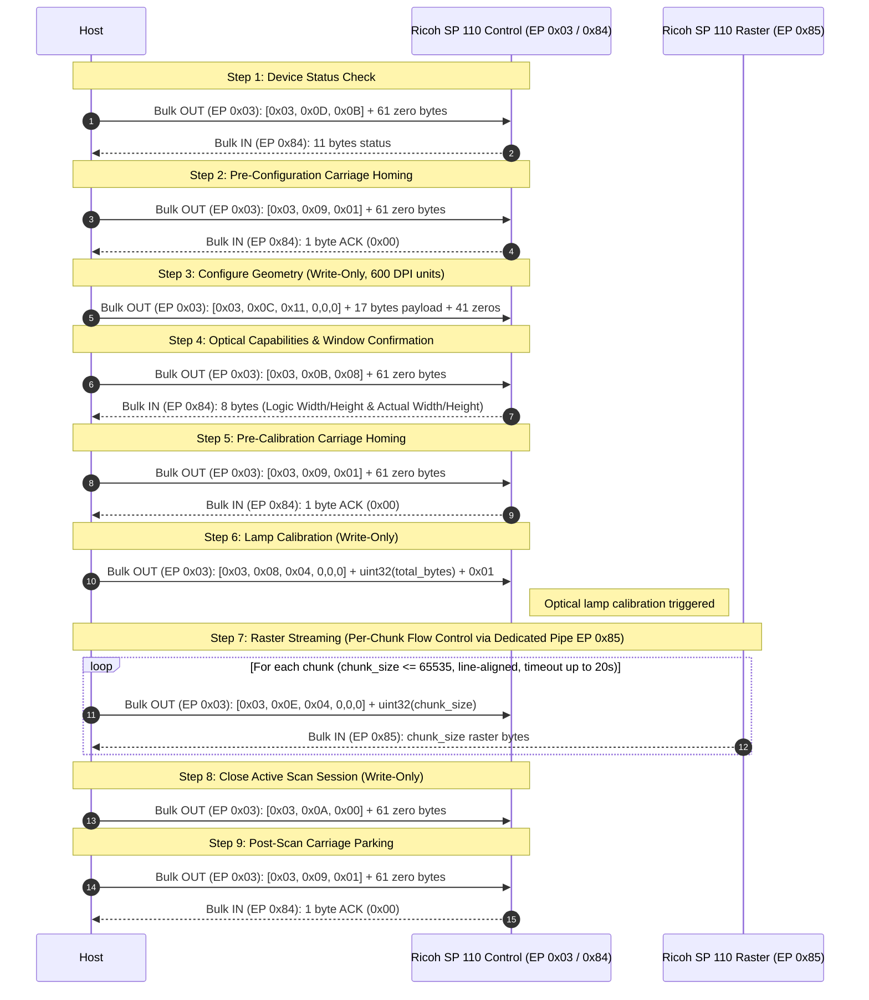

# Ricoh SP 110 Series Scanner Protocol Specification
Supports **Ricoh SP 112SF** (4-in-1 Flatbed + ADF) and **Ricoh SP 112SU** (3-in-1 Flatbed).

This document specifies the wire-level USB protocol used to configure, calibrate, and stream raster imagery from Ricoh SP 110 Series multifunction scanners. It is written as a clean-room hardware and protocol specification without reliance on proprietary operating system interfaces or vendor binary internals.

---

## 1. Hardware Identification & USB Descriptors

The device presents a standard USB composite interface topology:
- **Vendor ID (VID)**: `0x05CA` (Ricoh Co., Ltd.)
- **Product ID (PID)**:
  - `0x0449`: **Ricoh SP 112SF** (4-in-1 model with Flatbed and Automatic Document Feeder)
  - `0x0448`: **Ricoh SP 112SU** (3-in-1 model with Flatbed only)
- **Interfaces**:
  - **Interface 0 (Class 0xFF Vendor Specific)**: Scanner Subsystem
    - **EP 3 OUT (`0x03`)**: Bulk Command OUT endpoint (accepts fixed 64-byte command packets)
    - **EP 4 IN (`0x84`)**: Control / Status Response IN endpoint (status responses `0x0D`, homing ACKs `0x09`, and optical capabilities `0x0B`)
    - **EP 5 IN (`0x85`)**: Dedicated High-Speed Raster IN endpoint (streams raw image data chunks)
  - **Interface 1 (Class 7 Printer)**: Printer Port (`0x01` OUT, `0x82` IN)
  - **Interface 2 (Class 7 Printer)**: Secondary Printer Channel (`0x06` OUT, `0x87` IN)

---

## 2. Command Architecture & 64-Byte Packet Framing

All host commands transmitted to Bulk OUT (EP `0x03`) use a fixed **64-byte (`0x40`) frame structure**.

### 2.1 Packet Header Structure (64-byte buffer)

| Offset (Bytes) | Size | Description |
|---|---|---|
| `0x00` | 1 byte | Command Preamble: fixed constant `0x03` |
| `0x01` | 1 byte | Command Subtype / Opcode identifier |
| `0x02` | 1 byte | Length field declared in packet header |
| `0x03 .. 0x05` | 3 bytes | Reserved (zeroed) |
| `0x06 .. 0x16` | 17 bytes | Parameter payload (used in Geometry configuration) |
| `0x17 .. 0x3F` | 41 bytes | Zero-padded to 64 bytes (`0x40`) |

---

## 3. Command Index & Opcode Mapping

| Cmd ID | Opcode Name | Subtype (`pkt[1]`) | Header Len (`pkt[2]`) | Response on EP `0x84`? | Description |
|---|---|---|---|---|---|
| **1** | `OP_QUERY_STATUS` | `0x0D` | `0x0B` (11) | **Yes (11 bytes)** | Queries scanner status, hardware capabilities, and paper sensor states |
| **2** | `OP_SET_GEOMETRY` | `0x0C` | `0x11` (17) | **NO (Write-Only)** | Configures DPI, color mode, scan window geometry, and paper source |
| **3** | `OP_PARK_CARRIAGE` | `0x09` | `0x01` (1) | **Yes (1 byte ACK)** | Returns optical carriage to home sensor; acknowledges with `0x00` |
| **4** | `OP_GET_OPTICAL_CAPS`| `0x0B` | `0x08` (8) | **Yes (8 bytes)** | Queries optical sensor capabilities and raster dimensions |
| **5** | `OP_CALIBRATE_LAMP` | `0x08` | `0x04` (4) | **NO (Write-Only)** | Calibrates lamp / optical sensor; payload: `uint32(total_bytes) + 0x01` |
| **6** | `OP_REQUEST_CHUNK` | `0x0E` | `0x04` (4) | **NO (Write-Only)** | Requests raster chunk transfer; payload: `uint32(chunk_size)` per transfer |
| **7** | `OP_FINISH_SCAN` | `0x0A` | `0x00` (0) | **NO (Write-Only)** | Closes active scan session; dispatched on scan completion or abort |

### Auxiliary Feeder Control Opcodes
- **`0x0F`** (`OP_FEEDER_STATUS`, Header Len `0x01`): Queries ADF document feeder status / paper motion.
- **`0x10`** (`OP_FEEDER_ADVANCE`, Header Len `0x01`, payload `[0x01]` or `[0x02]`): Engages ADF feed rollers to advance paper.
- **`0x11`** (`OP_FEEDER_EJECT`, Header Len `0x01`): Ejects document from ADF paper path.

> [!IMPORTANT]
> **Write-Only Commands**: Commands 2 (`0x0C`), 5 (`0x08`), 6 (`0x0E`), and 7 (`0x0A`) do NOT return a response packet over Bulk IN. Attempting to read a response for these commands causes a timeout error (`LIBUSB_ERROR_TIMEOUT / -7`) and halts the endpoint.

---

## 4. Scan Geometry & Parameter Payload (17 Bytes)

When configuring a scan session via Command ID 2 (`OP_SET_GEOMETRY`, Subtype `0x0C`), the 17-byte parameter block is written starting at `pkt[6]` (`0x06 .. 0x16`).

All coordinate parameters (StartX, StartY, Width, Height) **must be scaled to 600 DPI base units**:
$$\text{coord\_600} = \frac{\text{coord\_dpi} \times 600}{\text{dpi}}$$

```text
Byte 0:  Resolution Code:
         0x01 = 200 DPI and 300 DPI (Standard optical speed & stepping)
         0x02 = 600 DPI (High-resolution optical mode / half-stepping)
Byte 1:  ScanMode (Hardware Color format):
         0x02 = 8-bit Grayscale (also used for 1-bit Lineart via software thresholding)
         0x03 = 24-bit RGB Color (Planar scanlines)
Byte 2:  Brightness / Contrast adjustments (0x00 default)
Byte 3:  Papersize / Threshold flag (0x00 default)
Byte 4:  StartX (Low Byte)   [16-bit little-endian, 600 DPI units]
Byte 5:  StartX (High Byte)
Byte 6:  StartY (Low Byte)   [16-bit little-endian, 600 DPI units]
Byte 7:  StartY (High Byte)
Byte 8:  Width (Low Byte)    [16-bit little-endian, 600 DPI units: (width_px * 600) / dpi]
Byte 9:  Width (High Byte)
Byte 10: Height (Low Byte)   [16-bit little-endian, 600 DPI units: (height_px * 600) / dpi]
Byte 11: Height (High Byte)  [Incremented if odd for 600 DPI ADF]
Byte 12: Duplex / Paper Source Selection
         0x00 = Flatbed
         0x01 = Automatic Document Feeder (ADF)
Byte 13: Xresolution (Low Byte)  [Custom DPI if Byte 0 == 0x03]
Byte 14: Xresolution (High Byte)
Byte 15: Yresolution (Low Byte)
Byte 16: Yresolution (High Byte)
```

---

## 5. Status & Optical Capabilities Response Layouts

### 5.1 Status Response (`OP_QUERY_STATUS`, Subtype `0x0D`, 11 Bytes)
When querying status with Subtype `0x0D`, the scanner returns an **11-byte response** on EP `0x84`:
- **`Byte[0]`**: Hardware Capability & Subsystem Status:
  - **`Bit 0` (`0x01`)**: **ADF Unit Installed** (`1` = SP 112SF 4-in-1 with ADF; `0` = SP 112SU 3-in-1 Flatbed only).
  - **`Bit 1` (`0x02`)**: Printer Engine Communication Ready (`1` = Online).
  - **`Bit 2..6` (`0x7C`)**: Reserved / ASIC revision flags (typically `0x7E` or `0x7F`).
- **`Byte[1]`**: Sensor Switch States (Real-time physical microswitches):
  - **`Bit 0` (`0x01`)**: **ADF Document Tray Switch** (`1` = Document loaded in feeder tray; `0` = Tray empty). Used by SANE to return `SANE_STATUS_NO_DOCS`.
  - **`Bit 1` (`0x02`)**: Flatbed Platen Cover Open Switch (`1` = Open, `0` = Closed).
  - **`Bit 2` (`0x04`)**: Paper Jam Sensor (`1` = Paper jammed in feed path).
  - **`Bit 3` (`0x08`)**: ADF Feed Mechanism Active (`1` = Feed motor running / page in transit).
- **`Byte[2]`**: Optical Carriage Home Sensor (`0x00` = Carriage parked at Home sensor; `> 0` = Carriage offset / traveling).
- **`Byte[3..8]`**: Reserved / internal diagnostic counters.
- **`Byte[9]`**: Hardware Error Code (`0x00` = Ready / Normal; non-zero indicates optical lamp failure, stepper motor stall, or ADF misfeed).
- **`Byte[10]`**: Packet Handshake ACK Byte (`0x00` = Success).

### 5.2 Optical Capabilities & Scan Window (`OP_GET_OPTICAL_CAPS`, Subtype `0x0B`, 8 Bytes)
Immediately after geometry configuration (Command 2), the host queries **Command 4 (`0x0B`)** to obtain hardware-confirmed raster dimensions:
- **`Byte[0..1]`**: **`Logic Width`** (`uint16` little-endian): Line pitch in pixels (including ASIC padding)
- **`Byte[2..3]`**: **`Logic Height`** (`uint16` little-endian): Actual raster lines in scan
- **`Byte[4..5]`**: **`Actual Width`** (`uint16` little-endian): Active optical sensor line width
- **`Byte[6..7]`**: **`Actual Height`** (`uint16` little-endian): Physical sensor line height

The raster buffer dimensions are derived directly from the response:
$$\text{bytes\_per\_line} = \text{Logic Width} \times (3 \text{ if Color else } 1)$$
$$\text{total\_bytes} = \text{bytes\_per\_line} \times \text{Logic Height}$$

---

## 6. Scan Initiation & Raster Streaming Sequence



### 6.1 Command 5 (`OP_CALIBRATE_LAMP`, `0x08`) Payload
The 5-byte payload is written starting at `pkt[6]`:
- `pkt[6..9]`: Total expected image bytes (`uint32` little-endian)
- `pkt[10]`: Mode flag `0x01`

### 6.2 Command 6 (`OP_REQUEST_CHUNK`, `0x0E`) Per-Chunk Triggering
`OP_REQUEST_CHUNK` is **dispatched before each individual raster chunk read**:
- `pkt[6..9]`: Requested chunk byte count (`uint32` little-endian: `lines_per_chunk * bytes_per_line`)
- Sending `OP_REQUEST_CHUNK` with a zero payload causes the motor to engage without transferring bulk raster data.

### 6.3 Line-Aligned Chunk Sizing Formula
To avoid raster line splitting across USB bulk transfer boundaries:
$$\text{lines\_per\_chunk} = \max\left(1, \left\lfloor \frac{65535}{\text{bytes\_per\_line}} \right\rfloor\right)$$
$$\text{chunk\_size} = \text{lines\_per\_chunk} \times \text{bytes\_per\_line}$$

### 6.4 Planar Color Scanline Ordering
24-bit color data streamed over Bulk IN (EP `0x85`) is **planar per scanline**, NOT pixel-interleaved:
- For a line of width $W$, the stream layout is:
  $$\text{Line Buffer} = [\underbrace{R_0, R_1, \dots, R_{W-1}}_{\text{Red Plane (} W \text{ bytes)}}, \underbrace{G_0, G_1, \dots, G_{W-1}}_{\text{Green Plane (} W \text{ bytes)}}, \underbrace{B_0, B_1, \dots, B_{W-1}}_{\text{Blue Plane (} W \text{ bytes)}}]$$
- To deliver standard interleaved RGB (`R0, G0, B0, R1, G1, B1...` for SANE/PPM), the host de-planarizes each line:
  $$\text{RGB}[3i + 0] = \text{Plane}_R[i], \quad \text{RGB}[3i + 1] = \text{Plane}_G[i], \quad \text{RGB}[3i + 2] = \text{Plane}_B[i]$$

### 6.5 600 DPI ADF Line Doubling
When scanning at 600 DPI via the ADF, the feeder motor advances at double speed relative to the sensor readout rate. The physical sensor produces half the vertical lines ($H/2$). The driver duplicates each received scanline in memory to produce the full 600 DPI vertical raster.

### 6.6 Active Scan Window vs. Hardware Logic Pitch ($2550$ vs $2560$)
The optical sensor hardware uses two distinct dimension metrics:
1. **Physical Line Pitch (`Logic Width` = 2560 pixels)**: The internal CCD readout clock and ASIC memory line buffer are padded to a multiple of 64/256 bytes (2560 bytes/line in Grayscale, 7680 bytes/line in Color).
2. **Active Image Window (`Actual Width` = 2550 pixels)**: The true active optical scan window for 8.5" Letter / A4 document scanning is 2550 pixels (7650 bytes/line in Color).
3. **Host Truncation**: The host driver reads chunks using the hardware pitch (2560 pixels), extracts the first 2550 active pixels, and discards the trailing 10 optical blanking/dummy pixels per scanline. This guarantees consistent line lengths and prevents heap memory corruption when delivering standard SANE/PNM image rows.

### 6.7 Dual-Endpoint Separation & 128 KB Buffer Safety
- **EP `0x84` (`ENDPOINT_RESP_IN`)**: Dedicated control pipe for command handshakes (Status `0x0D`, Cancel/Home ACK `0x09`, Capabilities `0x0B`).
- **EP `0x85` (`ENDPOINT_RASTER_IN`)**: Dedicated high-speed streaming pipe for raw image data.
- **Memory Safety (128 KB Buffer Rule)**: Drivers should allocate at least 128 KB (`0x20000` = 131,072 bytes) for chunk buffers so that 512-byte USB burst boundaries cannot overflow adjacent memory heap chunks.

---

## 7. Software Reset & Carriage Homing (`--cancel` / `--home`)

If any previous scan was aborted, interrupted, or timed out, the scanner microcontroller and bulk endpoints can become stalled.

### 7.1 Protocol-Level Software Reset (Command 3)
Instead of power cycling the printer, send **Command 3 (`OP_PARK_CARRIAGE`, Subtype `0x09`)**:
- **Python CLI**: `python3 ricoh_sp110_scanner.py --cancel` (or `--home`)
- **Packet Structure**:
  - `pkt[0]` = `0x03` (Preamble)
  - `pkt[1]` = `0x09` (`OP_PARK_CARRIAGE`)
  - `pkt[2]` = `0x01` (Header length)
  - `pkt[3..63]` = `0x00` (Zero padding)
- **Response**: 1-byte ACK `0x00` returned on Bulk IN (`0x84`).
- Returns the optical carriage back to the home sensor and restores scanner ready state.

> [!CAUTION]
> **Do NOT use hardware port reset (`libusb_reset_device` / `USBDEVFS_RESET`)**:
> On this composite multifunction device (`VID 0x05CA, PID 0x0449`), issuing a hardware USB bus reset on the parent hub port while interfaces are claimed wedges the shared USB PHY bridge controller. The device will hang in reset and vanish from the USB bus (`lsusb` will not show it) until a cold physical power cycle. Always use software endpoint clearance (`libusb_clear_halt`) and protocol Command 3 (`OP_PARK_CARRIAGE`) instead.

