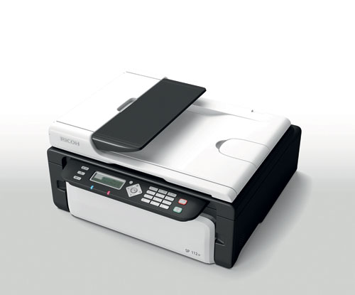
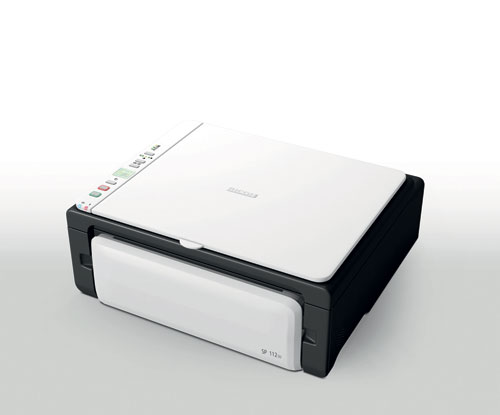

# Ricoh SP 110 Series Linux SANE Scanner Driver

An open-source SANE backend and standalone driver utility for the **Ricoh SP 112SF** (4-in-1 ADF) and **Ricoh SP 112SU** (3-in-1 Flatbed) multifunction printers on Linux systems.

---

## Supported Hardware

| Ricoh SP 112SF | Ricoh SP 112SU |
|:---:|:---:|
|  |  |

| Model | Hardware Profile | USB VID / PID | USB Interface Endpoints |
|---|---|---|---|
| **Ricoh SP 112SF** | 4-in-1 (Flatbed + Automatic Document Feeder) | `05CA:0449` | EP `0x03` (OUT), EP `0x84` (Control IN), EP `0x85` (Raster IN) |
| **Ricoh SP 112SU** | 3-in-1 (Flatbed only) | `05CA:0448` | EP `0x03` (OUT), EP `0x84` (Control IN), EP `0x85` (Raster IN) |

Both models share an identical USB packet protocol, with hardware capability autodetection distinguishing the presence of the motorized ADF unit.

---

## Features & Architecture

- **SANE Standard v1.0 Compliance**: Seamlessly integrates into system SANE services. Works out-of-the-box with `scanimage`, Simple Scan, XSane, and web-based scanning applications (e.g. ScanservJS).
- **Dual-Endpoint I/O Architecture**:
  - **EP `0x84` (Control/Status Pipe)**: Dispatches hardware status queries, lamp calibration handshakes, and homing acknowledgments.
  - **EP `0x85` (High-Speed Raster Pipe)**: Dedicated transfer channel for raw image scanline streams.
- **Color & Grayscale Modes**:
  - **Color**: 24-bit RGB with real-time planar-to-interleaved pixel de-planarization.
  - **Grayscale**: 8-bit Gray (`SANE_FRAME_GRAY`).
  - **Monochrome (Lineart)**: Fast software-binarized 1-bit Lineart with configurable `--threshold`.
- **Optical & Subsampled Resolutions**: Support for **75, 100, 150, 200, 300, and 600 DPI** scanning (75, 100, 150, and 200 DPI implemented via fast on-the-fly subsampling from the 300 DPI hardware optical stream).
- **Hardware Region Cropping & Enhancement Controls**:
  - Full hardware scan window offset (`--tl-x`, `--tl-y`, `--br-x`, `--br-y`) and predefined paper sizes (`A4`, `A5`, `A6`, `B5`, `B6`, `Legal`, `Letter`, `Max`, `Custom`).
  - Real-time 256-entry tone-mapping LUT for `--brightness` (`-100..100%`), `--contrast` (`-100..100%`), `--negative` (`yes`/`no` color/grayscale/lineart inversion), and 1-bit `--threshold` (`0..255`).
  - Standard `--preview` mode (`75 DPI` fast preview acquisition without overwriting target resolution).
- **Automatic Document Feeder (ADF) & Hardware Sensors**:
  - Real-time tray paper sensor polling (`--page-loaded` read-only hardware sensor option, plus `SANE_STATUS_NO_DOCS` when tray is empty for seamless multi-page batch scanning).
  - Automatic paper jam detection and recovery (`SANE_STATUS_JAMMED`).
  - Full hardware stream synchronization between pages.
  - Hardware line doubling support for high-speed 600 DPI feeding.
- **Safe Session Management & Software Reset**:
  - Implements clean two-stage session teardown (`OP_FINISH_SCAN` followed by `OP_PARK_CARRIAGE`).
  - Carriage homing and protocol soft-reset (`--cancel`) recovers stalled scanner states without risky USB bus PHY resets.
- **Standalone Python Driver**: Self-contained CLI tester app written with direct `libusb-1.0` ctypes bindings (zero pip dependencies).

---

## Repository Contents

- **`driver/`**: Open-source C SANE backend (`libsane-ricoh_sp110`), standalone Python scanning app, configuration files, and build scripts.
  - `driver/c/`: C source code (`ricoh_sp110.c`, `ricoh_sp110.h`, `Makefile`) and Docker compilation helper.
  - `driver/python/`: Zero-dependency Python CLI scanning utility (`ricoh_sp110_scanner.py`).
  - `driver/sane.d/`: Backend configuration (`ricoh_sp110.conf`) and udev permissions rule (`99-ricoh-sp110.rules`).
- **[`PROTOCOL.md`](PROTOCOL.md)**: Clean-room specification of the USB protocol, 64-byte framing, and sequence diagrams.
- **`bundle/`**: Distribution bundle ready for deployment to target Linux machines.
- **[`deploy_driver.sh`](deploy_driver.sh)**: SSH/SCP deployment script for building and deploying to remote servers.

---

## Driver Usage Instructions

### 1. Standalone Python Driver
Run the Python driver directly (requires system `libusb-1.0-0` installed):
```bash
# Check device status and ADF paper sensor
./driver/python/ricoh_sp110_scanner.py --status

# Return carriage to home position and software-reset engine
./driver/python/ricoh_sp110_scanner.py --cancel

# Scan 300 DPI Gray to test_gray.pnm
./driver/python/ricoh_sp110_scanner.py --scan test_gray.pnm --dpi 300 --mode gray --source flatbed

# Scan 300 DPI 24-bit Color to test_color.pnm
./driver/python/ricoh_sp110_scanner.py --scan test_color.pnm --dpi 300 --mode color --source flatbed

# Scan 100 DPI Color Flatbed (downsampled 2:1 from 200 DPI hardware scan)
./driver/python/ricoh_sp110_scanner.py --scan test_100.pnm --dpi 100 --mode color --paper-size a4

# Scan 300 DPI A4 Color Flatbed
./driver/python/ricoh_sp110_scanner.py --scan test_a4.pnm --dpi 300 --mode color --paper-size a4

# Scan from ADF (SP 112SF only) Legal format
./driver/python/ricoh_sp110_scanner.py --scan test_legal.pnm --dpi 300 --mode gray --source adf --paper-size legal
```

### 2. C SANE Backend Compilation & Installation
On a Linux system with build tools (`gcc`, `libusb-1.0-0-dev`, `libsane-dev`), or using the pre-packaged Docker builder:
```bash
# Compile natively
cd driver/c
make
sudo make install

# Or compile via Docker (no host dev dependencies required)
./driver/c/build_with_docker.sh
```

Once installed, the scanner is recognized by standard SANE tools:
```bash
# List devices
scanimage -L

# Query options including available paper sizes (A4, A5, A6, B5, B6, Legal, Letter)
scanimage -d ricoh_sp110 -A

# Scan 100 DPI Color Flatbed (subsampled 2:1 on the fly)
scanimage -d ricoh_sp110 --paper-size A4 --resolution 100 --mode Color > test_100.pnm

# Scan A4 Color Flatbed
scanimage -d ricoh_sp110 --paper-size A4 --resolution 300 --mode Color > test_a4.pnm

# Scan A5 Grayscale Flatbed
scanimage -d ricoh_sp110 --paper-size A5 --resolution 300 --mode Gray > test_a5.pnm

# Scan Legal from ADF (SP 112SF only)
scanimage -d ricoh_sp110 --source ADF --paper-size Legal --resolution 300 --mode Gray > test_legal.pnm

# Scan 150 DPI Monochrome (1-bit Lineart) with custom threshold
scanimage -d ricoh_sp110 --resolution 150 --mode Lineart --threshold 180 --format=png -o test_lineart.png

# Scan with brightness/contrast adjustment and custom crop region
scanimage -d ricoh_sp110 --resolution 150 --mode Gray --brightness 20 --contrast 30 -l 30 -t 30 -x 100 -y 100 --format=png -o test_crop.png

# Fast 75 DPI preview scan and negative image inversion
scanimage -d ricoh_sp110 --mode Color --preview=yes --format=png -o test_preview.png
scanimage -d ricoh_sp110 --resolution 150 --mode Gray --negative=yes --format=png -o test_negative.png

# Check live ADF paper tray sensor status
scanimage -d ricoh_sp110 -A | grep page-loaded
```


---

## Remote Deployment via SSH / SCP

A dedicated deployment script [`deploy_driver.sh`](deploy_driver.sh) is provided to bundle and transfer the compiled driver, installer, configuration files, and documentation to any remote target machine:

```bash
# 1. Transfer bundle to target host
./deploy_driver.sh user@192.168.1.50

# 2. Transfer with custom SSH port
./deploy_driver.sh -p 2222 user@192.168.1.50

# 3. Transfer and automatically run sudo ./install.sh on target
./deploy_driver.sh --install user@192.168.1.50

# 4. Transfer, install, and copy standalone Python test utility to a custom folder:
./deploy_driver.sh --install -s /opt/cups/scans user@192.168.1.50
```

### Script Directory Parameterization
The test utility `ricoh_sp110_scanner.py` can be copied to a dedicated directory during installation (e.g. for web scan servers or administrative scripts):
- Via CLI flag: `sudo ./install.sh -s /path/to/dir` (or `./deploy_driver.sh --install -s /path/to/dir user@host`)
- Via environment variable: `SCAN_SCRIPT_DIR=/path/to/dir sudo -E ./install.sh`

### What is Transferred:
- `libsane-ricoh_sp110.so.1.0.0` & symlinks (precompiled 64-bit SANE library)
- `ricoh_sp110.conf` (SANE backend config)
- `99-ricoh-sp110.rules` (Udev USB permissions)
- `install.sh` (Self-contained target installer)
- `README.md` (Target usage guide)
- `ricoh_sp110_scanner.py` (Standalone Python tester app)
